# Architectural stage review

Local review branch: `feat/stage-architectural-review`, based on main `1eeadca` (PR #60).
Prepared for Raúl's approval before publishing or merging. A GitHub issue and PR will be created at publication;
this local review is intentionally not shared yet.

## What the family experiences

The home is revealed through the team's cloud descent, with larger framing and quieter camera motion. Warm plaster, timber details,
glazing, paving, contact shadows and reflections give the team's existing modern home more depth.
The revised blue and violet palette follows the project's Sherpas-inspired colors, with warm architecture,
directional sunlight, darker roofs, sky reflections, animated water ripples and fuller foliage.
Desktop keeps the explanation alongside the home; mobile keeps the home above the scrolling explanation.
Each part still responds to the family's actual plan. The opening explicitly calls the home an illustration.

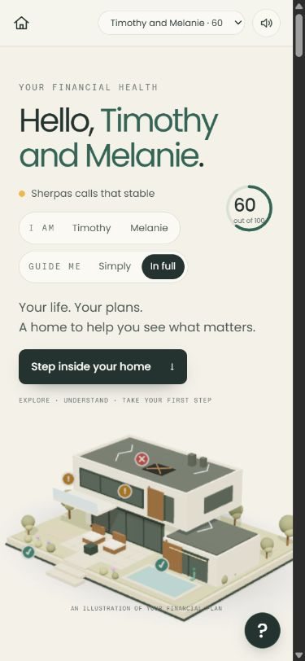

## Second visual review: daylight and a reason to explore

Raúl found the first cream/green version too muted. The second review restores contrast and color separation:
warm key light from the front left, cool fill from behind, stronger ground shadows, blue reflected glazing,
charcoal roofs, timber slats, local water textures with slow motion and additional foliage clusters.
The background is a blue CSS gradient behind a transparent canvas; no new external media is loaded.

The opening presents a suggested question from `intro.visual.data.worries`, followed, when available,
by the existing `timeline.events` savings-run-out age. This makes the score's limitation visible early:
Samantha scores 82 but her current plan runs out at 73. These are supplied facts, not a fresh projection or
a claim that the family said the suggested question. The opening score is shown directly, without counting
through intermediate values. Narrated source text remains unchanged.

Navigation now names the financial concepts (Protection, Debt, Cash flow, Emergency fund, Investments),
and each focused view explicitly labels the concept alongside the house part. Preview feedback also works
when improving a part whose starting state is already solid; it never flashes nonexistent cracks.

[First visual review, for comparison](../review-assets/architectural/desktop-home-v1.jpg).

Second review checks: `check.sh` still passes 171 tests; all eight pages generated; JavaScript syntax checks
pass; desktop 1280×800 and mobile 390×844 checked. Samantha's step preview shows 84, explicitly labelled as
an individual preview, with zero completed steps. Physical iPhone and live voice/model rehearsal remain pending.

## Explore, preview, complete

### Eighth review: distinct camera destinations and continuous routes

Each part now has a specific shot rather than five small variations on the overview: the roof from above,
the walls from a lower front/right angle, plumbing close over the pool, foundations low from the front/left,
and the garden from the left. Detail views deliberately crop unrelated areas while retaining the active part
and its state marker. Overview framing and the original cloud descent remain unchanged.

Camera transitions interpolate yaw and pitch along the shortest orbit, with a small pull-back and elevated
arc before settling closer. Quintic easing gives a smooth departure and arrival; duration grows from 1.55 s
with angular distance. Retargeting begins at the current pose. Existing slow-device fallbacks remain.

Chapter buttons and house-part navigation now use an interruptible 0.85–1.4 s scroll. The requested chapter
stays selected during the move, so passing intermediate sections does not repeatedly retarget the camera.
Wheel, touch, pointer and keyboard input cancel the move; reduced motion uses an immediate change. Mobile
activation follows the content below the sticky scene, fixing the previous-button selection after arrival.

Verified in-browser: all five destinations in the narrow viewport, roof and foundations at 1280×800, backward
navigation and responsive resize. The 3D canvas remains active, original score stays 82 and there is no
horizontal overflow. `check.sh`: 171 tests pass. Physical iPhone motion/performance still needs review.
No financial, narration, weather, completion or backend changes. Local review only.

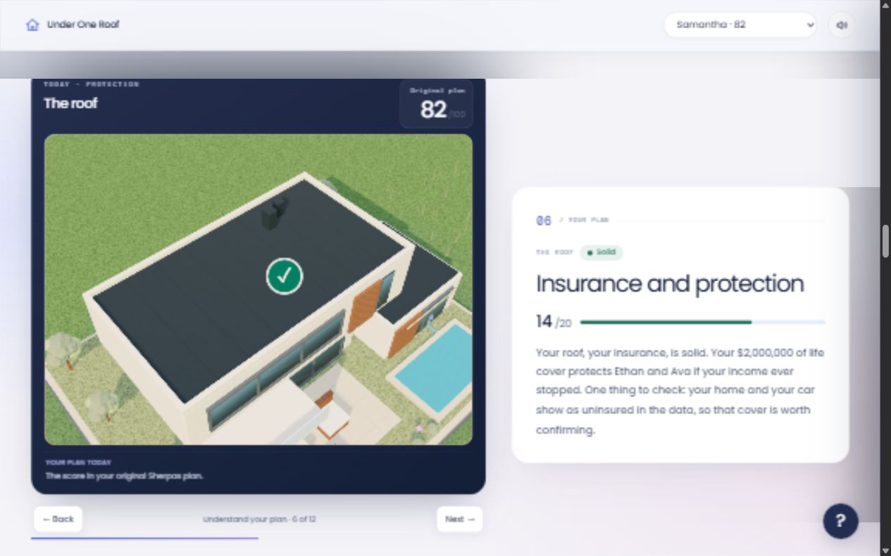
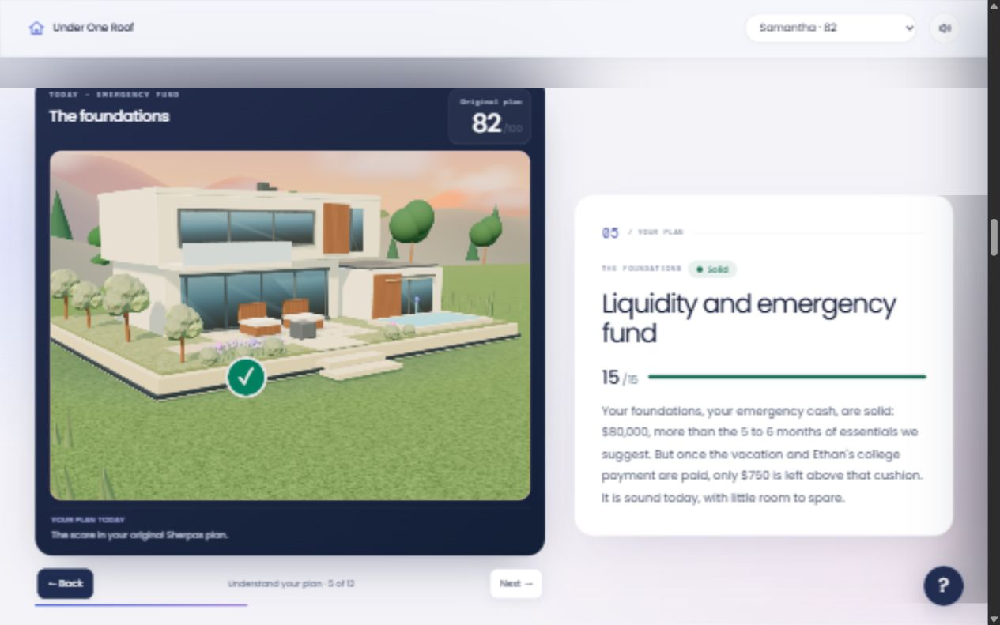
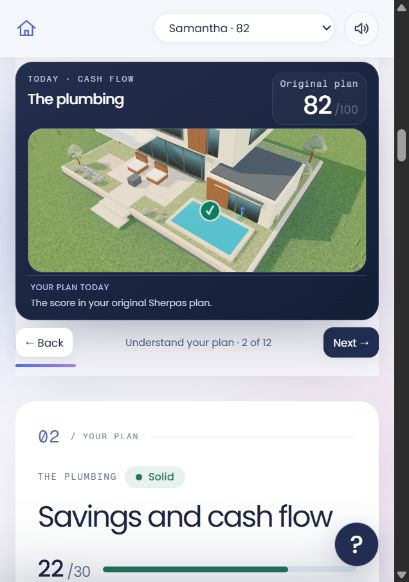

### Seventh review: a consistent design across the whole website

The new treatment extends beyond the house: midnight-blue opening, translucent score panel, a pale-green
entry button, porcelain chapter cards, numbered chapter headings, iris accents and a visible journey progress
line. The scene's dark frame separates the illustration from its financial explanation. Proposals use a
dedicated before/after score panel; the final choice, timeline, question panel and controls share the same
spacing, borders and focus treatment. Poppins and the project's blue/violet identity remain.

The landscape now uses three continuous ridgelines with slope shading and atmospheric distance, batched
mixed woodland, foreground planting and a flowering garden border. More directional light and a slightly
lower overview camera give the facade more presence. All scenery remains local and procedural.

A missing base color on the new instanced flowers initially triggered the 2D fallback. It was corrected and
the actual 3D canvas verified again in the browser. Departing-box snapshots can now render before the first
animation frame, covering refreshes partway through the page.

Validation: 171 tests pass, eight family/mode pages generated with mock voice, desktop 1440×1000 and the
default narrow viewport inspected. Manual wheel scrolling revealed the home at scroll 814.7 while it was
still pinned in the opening. No horizontal overflow in either inspected layout. Physical iPhone performance
is still pending. Narration, financial facts, contract, score/weather mapping and preview/completion semantics
are unchanged. No publication or merge yet.

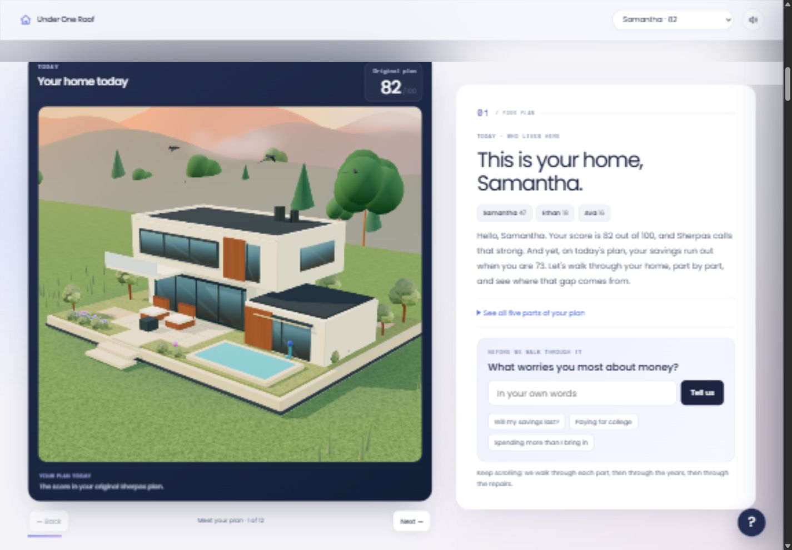
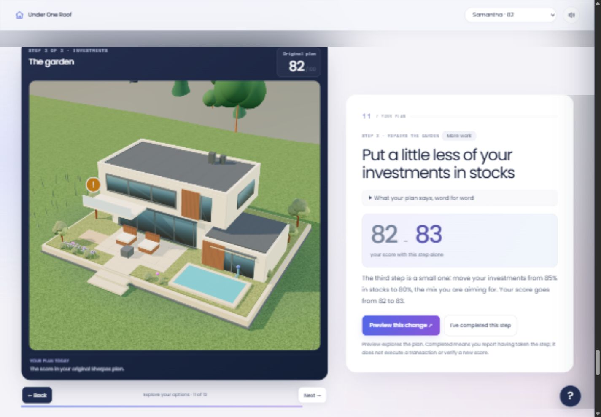
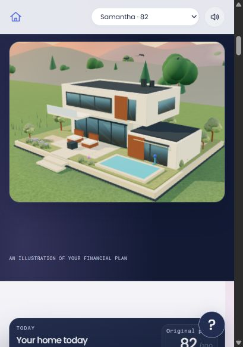

### Sixth review: manual-scroll reveal and atmosphere polish

Raúl reported that manual scrolling never revealed the house. The previous handoff could freeze the opening
on a mid-cloud still before the flight was complete. In addition, the hero's inherited `overflow: hidden`
prevented its picture from sticking to the viewport.

The opening now owns an additional 700-pixel scroll runway. Its picture stays pinned while descending, the
flight completes before the picture is released, and the house remains revealed for at least a 180-pixel
hold before the next section. Desktop keeps both columns in view; mobile pins the picture after the greeting.
The renderer cannot transfer to the journey until the descent is complete. The hero no longer creates an
overflow scroll container that breaks sticky positioning; the picture's own rounded box still clips its content.

Manual wheel validation (without the entrance button), narrow viewport: scroll 603 → picture pinned at top 72
while descending; scroll 814 → house fully visible at top 72, bottom 352, renderer still in the opening and
the journey still below it. This is a visual/browser regression check, separate from the functional test suite.

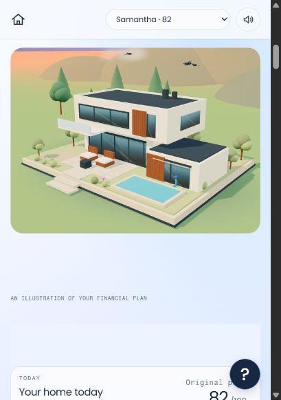

Atmosphere polish retains the team's original score/weather palette: a sky gradient aligned with the real
horizon removes the hard color seam; cloud undersides gain soft shading. Grass uses fine local texture at
world-appropriate scale, roof surfaces gain subtle grain/seams, paving retains mineral grain, and glass glints
are reduced. Textures are generated locally, reused and disposed; no new service or asset dependency is added.

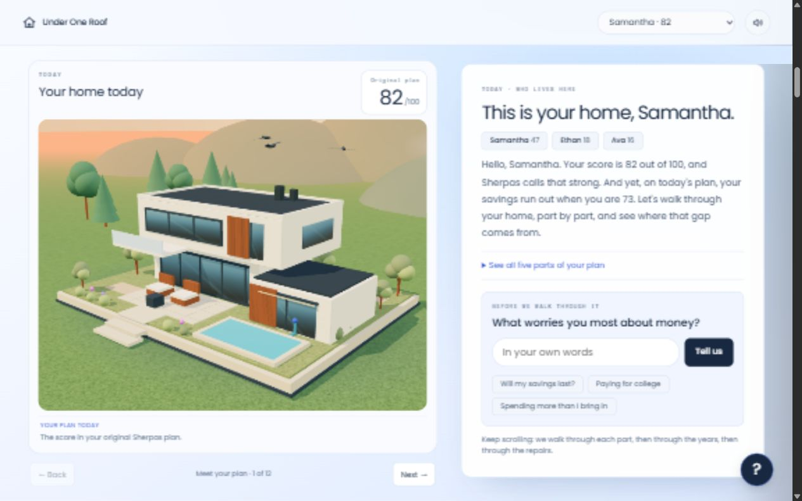

Validation: 171 functional tests pass, scene JavaScript parses, and the manual reveal is checked in-browser.
Physical iPhone frame rate remains unverified.

### Fifth review: the original descent through clouds

At Raúl's explicit request, the original cloud-to-home camera path replaces the fourth review's added
orbit/dolly arrival. `INTRO` uses the team's original camera position and look-at target; the original high
cloud deck (26 puffs) is restored above the landscape. Opening scroll progress drives `setIntro(0..1)` over
85% of the hero height, so the camera begins above the clouds, passes through them, and settles at the home.
There is no extra arrival turn competing with that descent.

The contained renderer and local handoff stills remain, keeping the scene out of the greeting, score and
explanation. The button plays a smooth 2.2-second descent from the current scroll position; wheel, touch,
pointer or keyboard input cancels the automatic scroll. Manual scrolling retains direct, reversible control.
Reduced-motion preferences use an immediate scroll and the existing SVG fallback.

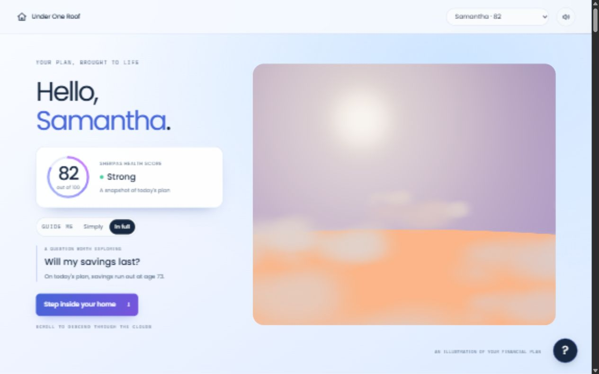

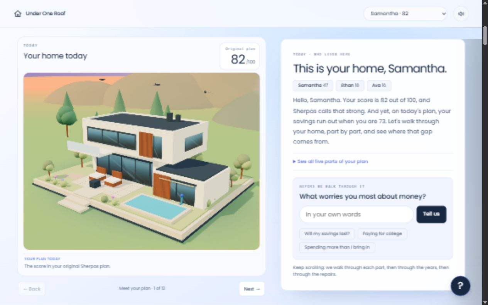

Validation: `check.sh` passes 171 tests; generated page and scene JavaScript parse. Browser: opening starts at
scroll 0 above the clouds; desktop and 390×844 mobile checks reach the journey at top 0 with the canvas inside `sceneViewport` and
the original score 82 unchanged. Physical iPhone performance remains a release check.

### Fourth review: landscape, score card and a contained camera journey

Raúl asked to restore the landscape and motion that made the team's original feel alive, and to fix the
opening score and the house crossing the text during the opening-to-journey transition.

- Restored ground, seven layered terrain ridges, fourteen background trees with mixed foliage, drifting clouds
  and three articulated birds. The original score/weather mapping still governs rain, clear days and sunsets;
  birds fly in the corresponding fair-weather states. Water ripples and garden sway are retained.
- The opening score now uses a dedicated card: a centered 82/out-of-100 dial, Sherpas label, source assessment
  and a short explanation. No floats, viewport-positioned score, or overlap with the greeting or mode controls.
- Removed the full-viewport fixed canvas and interpolated viewport offsets. A single renderer now lives in the
  actual opening or scene container, both clipped locally. A locally rendered still remains in the departing
  container; no empty frame or floating canvas crosses the explanation.
- Scrolling drives a camera turn inside the picture. Entering the next scene adds a 1.6-second orbit/dolly arrival;
  a brief fade covers the container handoff. This is camera motion, not only a fade between two still pictures.
- Birds use curved wing outlines, body/head/tail geometry, articulated flapping, gliding intervals and banking.
  These are procedural 3D illustrations, not photorealistic footage.
- At short mobile heights the scene has enough minimum space for the score, picture and context. The current
  chapter remains anchored on resize. Reduced-motion and the existing 2D fallback remain supported.

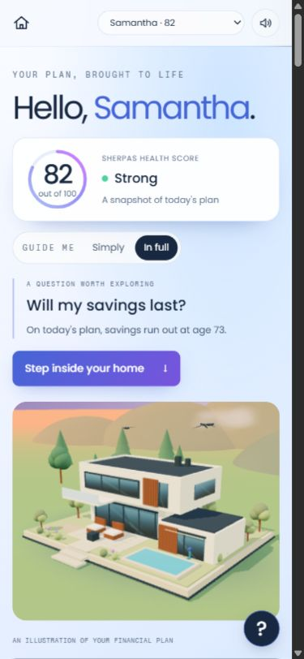

Validation: `check.sh` passes 171 tests and generated JavaScript parses. Browser checks cover 1280×800,
390×844 and 390×600: the dial is centered (under 0.01 CSS px geometric offset), one WebGL renderer is present,
both handoff stills load, the canvas stays inside its owning box, and the scene footer does not overrun the
panel at the shorter height. Physical iPhone motion/performance review is still required before release.

### Third review: original weather, a clearer reading flow

At Raúl's request, the team's original score-driven weather is restored. The original `WEATHER` palettes and
`healthOf` mapping remain the source: rain and grey skies for low scores, a clear day in the middle, and a warm
sunset for high scores. Material detail, reflections, directional lighting and a restrained cloud layer improve
the rendering. The sky gradient is adjusted for the house's downward-facing camera. The weather follows the
displayed scenario; an unscored combination retains the original score's weather rather than inventing one.

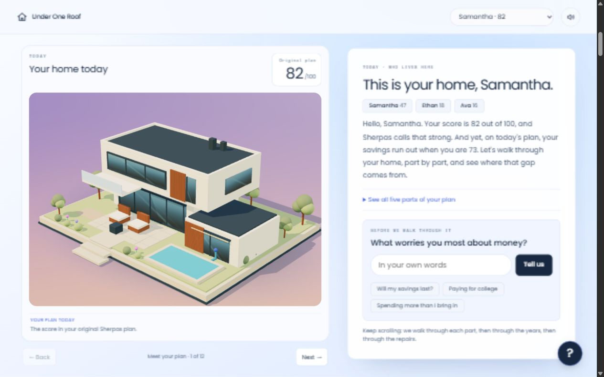

The picture now stays clipped to its own rounded viewing area, including the opening transition. Score,
scenario explanation and chapter navigation are outside the picture. Camera moves take 1.25 seconds and retain
the house's overall shape instead of extreme close-ups. Only the current part's marker is shown.

Back/Next and a phase/chapter counter provide explicit orientation. Desktop emphasizes a single active card;
mobile uses readable, opaque cards in normal document flow below an opaque, sticky scene. The initial five-part
summary is folded into a disclosure. Resizing anchors the current chapter under the scene to avoid losing the
text. Score labels are shorter, the denominator is more legible, and floating point-gain decorations are removed.

Validation: `check.sh` passes 171 tests; syntax checks pass; all eight family/mode pages generated. Browser
navigation verified through nine consecutive Next actions to chapter 10/12. Michael stays at 26 while reading;
previewing his second step displays 62 with zero completed steps and changes rain to the corresponding clearer
weather. Mobile geometry checked: score ends above the picture, the card starts below the stage, no horizontal
overflow at 390×844. Physical iPhone performance remains pending.

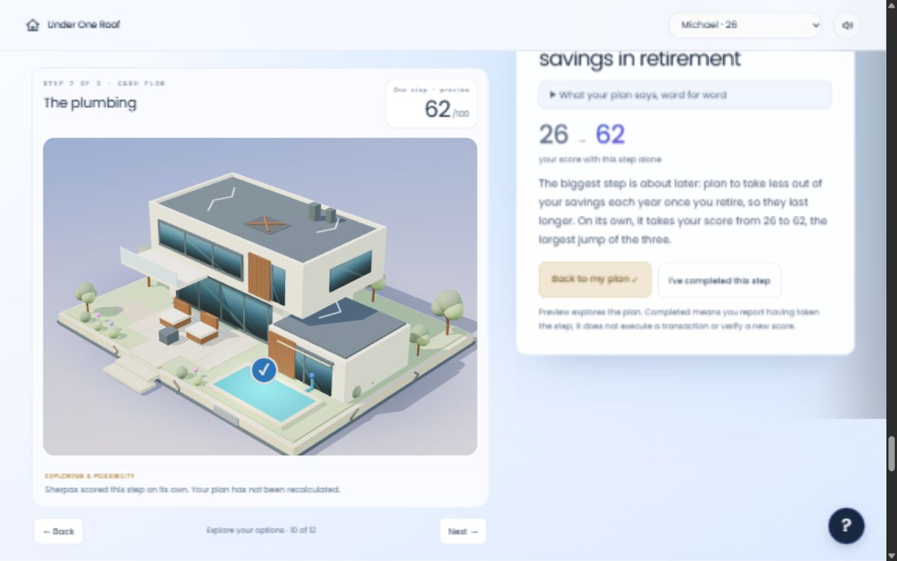

- Scrolling explains the original plan and never completes a step.
- **Preview this change** shows the supplied result of that step alone. It does not combine other confirmed steps
  with the preview, save completion, execute a transaction, or call an external model.
- **Back to my plan**, or moving to another chapter, ends the preview.
- **I've completed this step** records the family's report in this browser. Undo and reset remain available.
- The score label identifies original plan, individual scenario, combined scenario or an unavailable combined score.
  Reporting completion does not recalculate or verify a financial score.
- Multiple steps only display a combined score when Sherpas provided `all_moves` and every step is selected.
  Otherwise the score is a dash with an explanation, not the largest individual result or a sum.
- An individual preview uses its exact supplied score, even if it is lower than another step's result.
- A partial debt payment keeps the debt part's original diagnostic state. One of several changes to the same
  part also keeps its original diagnostic state. The visual is an illustration of selected changes, not a new diagnosis.
- The day-3 **Yes, I started** response does not mark a task completed. Its existing backend record and advisor
  handoff remain in place; the client no longer interprets starting as finishing.

## Relationship to the rubric

| Criterion | Contribution of this change |
| --- | --- |
| Engagement (20) | Home visible from the opening; larger framing; deliberate close-ups. |
| Understanding (20) | Consistent hierarchy, readable cards, explicit scenario labels and available scores only. |
| Action (20) | Try a step, compare its individual effect, choose a first move, report completion separately. |
| Personal (15) | Existing family data, concerns, modes and individual/couple selection preserved. |
| Creativity (15) | Develops the team's responsive home metaphor and visual repairs. |
| Idea note (10) | Existing submitted idea retained. This visual review does not claim to change its mark. |

## Implementation and scope

`web/architectural.css` and `web/plan-state.js` are embedded by `stage.py`: the HTML remains portable with its
SVG fallback. `web/house3d.js` keeps the team's mount/update/frame/dispose interface and vendored Three.js.
Textures and the reflection map are generated locally in small canvases; no downloaded models, new web services,
framework, paid assets or extra dependencies are needed. Chamfers and shading enhance the existing geometry.
This is an architectural illustration, not a photorealistic reconstruction.

No backend, schema, brain, guard, voice or colleague's visit log changes. Narrated source text is unchanged;
the local preview was generated with `VOICE_ENGINE=mock` and has no newly generated audio. Live AI answers
were not exercised against a team key. Existing API tests use mocks.

## Validation

- `VOICE_ENGINE=mock bash check.sh`: **171 passed**, full pipeline generated successfully.
- Generated all four families in both modes (8 family pages and the default page).
- Four new tests execute the actual JavaScript scenario and repair logic against the four real case fixtures.
- Browser: desktop at 1280×720 and mobile at 390×844; no horizontal overflow in checked mobile views.
- Michael: preview step 2 → 62, completed count stays 0; explicit completion persists after reload; undo → original 26.
- Michael: all-step preview → no combined score, completed count stays 0.
- Weah: all-step preview → supplied combined 78, walls remain cracked for the partial payment; undo restores 60.
- Simply: SVG displayed, no 3D canvas. Explicit `?house=2d` also remains available.
- Syntax checks for the scene JavaScript and the generated page script; `git diff --check` clean.
- **Still required:** physical iPhone performance check, user visual approval, and a live voice/AI rehearsal in
  the team's configured environment before release. Browser viewport tests do not establish device performance.

## Review locally

Preview: `http://127.0.0.1:8092/families/samantha-lewis/complete/index.html`.
Original comparison: `http://127.0.0.1:8091/families/samantha-lewis/complete/index.html`.

Try the family selector, preview an individual step, return to the original plan, confirm and undo completion,
and compare the all-step previews for Michael (no combined score) and the Weah family (combined score available).
The choice of the first move and the day-3 follow-up remain at the end of the experience.
