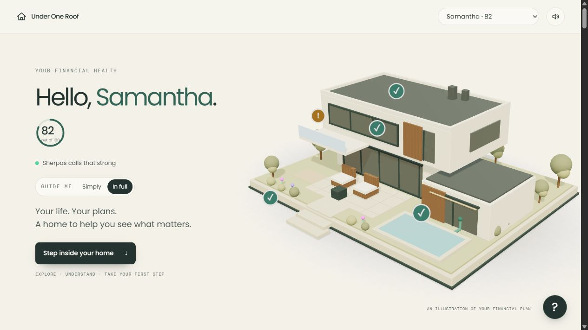

# Architectural stage review

Local review branch: `feat/stage-architectural-review`, based on main `1eeadca` (PR #60).
Prepared for Raúl's approval before publishing or merging. A GitHub issue and PR will be created at publication;
this local review is intentionally not shared yet.

## What the family experiences

The home is visible immediately, with larger framing and quieter camera motion. Warm plaster, timber details,
glazing, paving, contact shadows and studio reflections give the team's existing modern home more depth.
The same cream, forest-green and muted amber palette carries through the cards, labels and controls.
Desktop keeps the explanation alongside the home; mobile keeps the home above the scrolling explanation.
Each part still responds to the family's actual plan. The opening explicitly calls the home an illustration.

## Explore, preview, complete

- Scrolling explains the original plan and never completes a step.
- **Preview this change** shows the supplied result of that step alone. It does not combine other confirmed steps
  with the preview, save completion, execute a transaction, or call an external model.
- **Back to my plan**, or moving to another chapter, ends the preview.
- **I've completed this step** records the family's report in this browser. Undo and reset remain available.
- The score label identifies original plan, individual scenario, combined scenario or an unavailable combined score.
  Reporting completion does not recalculate or verify a financial score.
- Multiple steps only display a combined score when Sherpas provided `all_moves` and every step is selected.
  Otherwise the score is a dash with an explanation, not the largest individual result or a sum.
- An individual preview uses its exact supplied score, even if it is lower than another step's result.
- A partial debt payment keeps the debt part's original diagnostic state. One of several changes to the same
  part also keeps its original diagnostic state. The visual is an illustration of selected changes, not a new diagnosis.
- The day-3 **Yes, I started** response does not mark a task completed. Its existing backend record and advisor
  handoff remain in place; the client no longer interprets starting as finishing.

## Relationship to the rubric

| Criterion | Contribution of this change |
| --- | --- |
| Engagement (20) | Home visible from the opening; larger framing; deliberate close-ups. |
| Understanding (20) | Consistent hierarchy, readable cards, explicit scenario labels and available scores only. |
| Action (20) | Try a step, compare its individual effect, choose a first move, report completion separately. |
| Personal (15) | Existing family data, concerns, modes and individual/couple selection preserved. |
| Creativity (15) | Develops the team's responsive home metaphor and visual repairs. |
| Idea note (10) | Existing submitted idea retained. This visual review does not claim to change its mark. |

## Implementation and scope

`web/architectural.css` and `web/plan-state.js` are embedded by `stage.py`: the HTML remains portable with its
SVG fallback. `web/house3d.js` keeps the team's mount/update/frame/dispose interface and vendored Three.js.
Textures and the reflection map are generated locally in small canvases; no downloaded models, new web services,
framework, paid assets or extra dependencies are needed. Chamfers and shading enhance the existing geometry.
This is an architectural illustration, not a photorealistic reconstruction.

No backend, schema, brain, guard, voice or colleague's visit log changes. Narrated source text is unchanged;
the local preview was generated with `VOICE_ENGINE=mock` and has no newly generated audio. Live AI answers
were not exercised against a team key. Existing API tests use mocks.

## Validation

- `VOICE_ENGINE=mock bash check.sh`: **171 passed**, full pipeline generated successfully.
- Generated all four families in both modes (8 family pages and the default page).
- Four new tests execute the actual JavaScript scenario and repair logic against the four real case fixtures.
- Browser: desktop at 1280×720 and mobile at 390×844; no horizontal overflow in checked mobile views.
- Michael: preview step 2 → 62, completed count stays 0; explicit completion persists after reload; undo → original 26.
- Michael: all-step preview → no combined score, completed count stays 0.
- Weah: all-step preview → supplied combined 78, walls remain cracked for the partial payment; undo restores 60.
- Simply: SVG displayed, no 3D canvas. Explicit `?house=2d` also remains available.
- Syntax checks for the scene JavaScript and the generated page script; `git diff --check` clean.
- **Still required:** physical iPhone performance check, user visual approval, and a live voice/AI rehearsal in
  the team's configured environment before release. Browser viewport tests do not establish device performance.

## Review locally

Preview: `http://127.0.0.1:8092/families/samantha-lewis/complete/index.html`.
Original comparison: `http://127.0.0.1:8091/families/samantha-lewis/complete/index.html`.

Try the family selector, preview an individual step, return to the original plan, confirm and undo completion,
and compare the all-step previews for Michael (no combined score) and the Weah family (combined score available).
The choice of the first move and the day-3 follow-up remain at the end of the experience.
