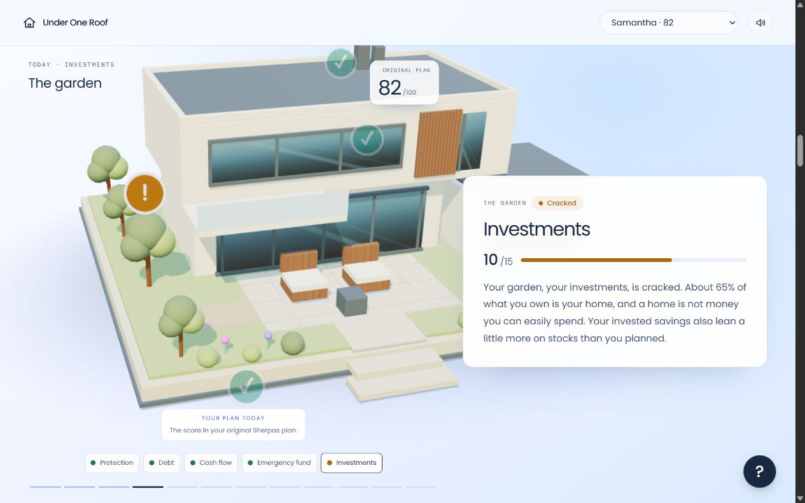
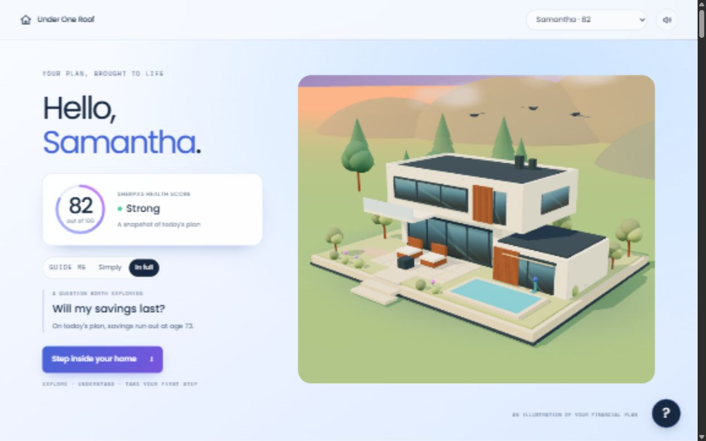
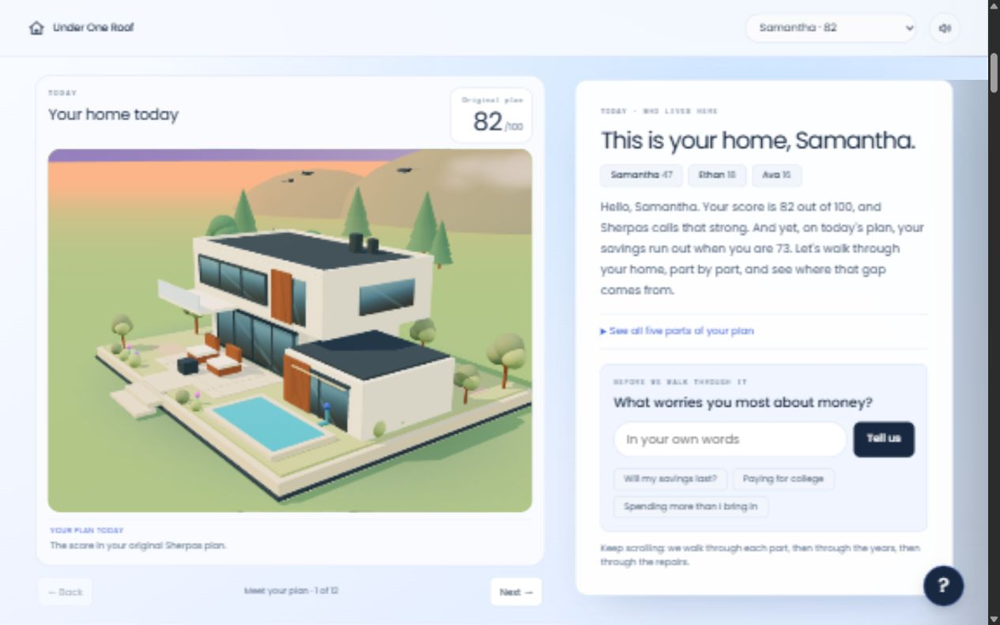
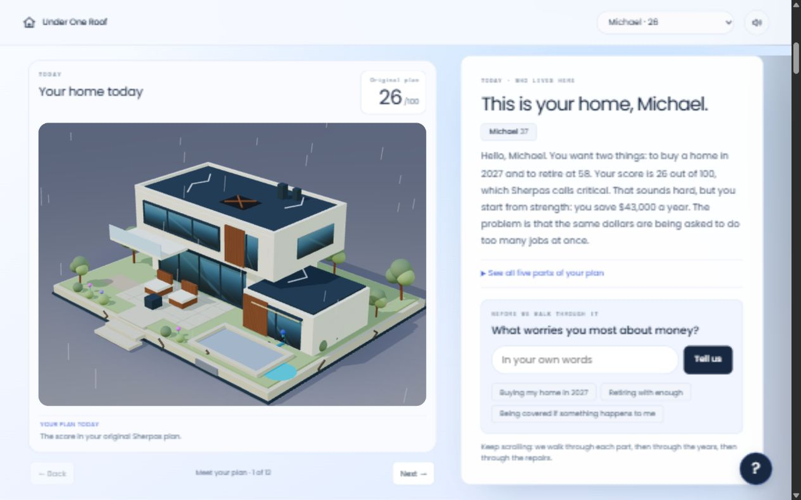

# Architectural stage review

Local review branch: `feat/stage-architectural-review`, based on main `1eeadca` (PR #60).
Prepared for Raúl's approval before publishing or merging. A GitHub issue and PR will be created at publication;
this local review is intentionally not shared yet.

## What the family experiences

The home is visible immediately, with larger framing and quieter camera motion. Warm plaster, timber details,
glazing, paving, contact shadows and reflections give the team's existing modern home more depth.
The revised blue and violet palette follows the project's Sherpas-inspired colors, with warm architecture,
directional sunlight, darker roofs, sky reflections, animated water ripples and fuller foliage.
Desktop keeps the explanation alongside the home; mobile keeps the home above the scrolling explanation.
Each part still responds to the family's actual plan. The opening explicitly calls the home an illustration.

## Second visual review: daylight and a reason to explore

Raúl found the first cream/green version too muted. The second review restores contrast and color separation:
warm key light from the front left, cool fill from behind, stronger ground shadows, blue reflected glazing,
charcoal roofs, timber slats, local water textures with slow motion and additional foliage clusters.
The background is a blue CSS gradient behind a transparent canvas; no new external media is loaded.

The opening presents a suggested question from `intro.visual.data.worries`, followed, when available,
by the existing `timeline.events` savings-run-out age. This makes the score's limitation visible early:
Samantha scores 82 but her current plan runs out at 73. These are supplied facts, not a fresh projection or
a claim that the family said the suggested question. The opening score is shown directly, without counting
through intermediate values. Narrated source text remains unchanged.

Navigation now names the financial concepts (Protection, Debt, Cash flow, Emergency fund, Investments),
and each focused view explicitly labels the concept alongside the house part. Preview feedback also works
when improving a part whose starting state is already solid; it never flashes nonexistent cracks.

[First visual review, for comparison](../review-assets/architectural/desktop-home-v1.jpg).

Second review checks: `check.sh` still passes 171 tests; all eight pages generated; JavaScript syntax checks
pass; desktop 1280×800 and mobile 390×844 checked. Samantha's step preview shows 84, explicitly labelled as
an individual preview, with zero completed steps. Physical iPhone and live voice/model rehearsal remain pending.

## Explore, preview, complete

### Fourth review: landscape, score card and a contained camera journey

Raúl asked to restore the landscape and motion that made the team's original feel alive, and to fix the
opening score and the house crossing the text during the opening-to-journey transition.

- Restored ground, seven layered terrain ridges, fourteen background trees with mixed foliage, drifting clouds
  and three articulated birds. The original score/weather mapping still governs rain, clear days and sunsets;
  birds fly in the corresponding fair-weather states. Water ripples and garden sway are retained.
- The opening score now uses a dedicated card: a centered 82/out-of-100 dial, Sherpas label, source assessment
  and a short explanation. No floats, viewport-positioned score, or overlap with the greeting or mode controls.
- Removed the full-viewport fixed canvas and interpolated viewport offsets. A single renderer now lives in the
  actual opening or scene container, both clipped locally. A locally rendered still remains in the departing
  container; no empty frame or floating canvas crosses the explanation.
- Scrolling drives a camera turn inside the picture. Entering the next scene adds a 1.6-second orbit/dolly arrival;
  a brief fade covers the container handoff. This is camera motion, not only a fade between two still pictures.
- Birds use curved wing outlines, body/head/tail geometry, articulated flapping, gliding intervals and banking.
  These are procedural 3D illustrations, not photorealistic footage.
- At short mobile heights the scene has enough minimum space for the score, picture and context. The current
  chapter remains anchored on resize. Reduced-motion and the existing 2D fallback remain supported.

Validation: `check.sh` passes 171 tests and generated JavaScript parses. Browser checks cover 1280×800,
390×844 and 390×600: the dial is centered (under 0.01 CSS px geometric offset), one WebGL renderer is present,
both handoff stills load, the canvas stays inside its owning box, and the scene footer does not overrun the
panel at the shorter height. Physical iPhone motion/performance review is still required before release.

### Third review: original weather, a clearer reading flow

At Raúl's request, the team's original score-driven weather is restored. The original `WEATHER` palettes and
`healthOf` mapping remain the source: rain and grey skies for low scores, a clear day in the middle, and a warm
sunset for high scores. Material detail, reflections, directional lighting and a restrained cloud layer improve
the rendering. The sky gradient is adjusted for the house's downward-facing camera. The weather follows the
displayed scenario; an unscored combination retains the original score's weather rather than inventing one.

The picture now stays clipped to its own rounded viewing area, including the opening transition. Score,
scenario explanation and chapter navigation are outside the picture. Camera moves take 1.25 seconds and retain
the house's overall shape instead of extreme close-ups. Only the current part's marker is shown.

Back/Next and a phase/chapter counter provide explicit orientation. Desktop emphasizes a single active card;
mobile uses readable, opaque cards in normal document flow below an opaque, sticky scene. The initial five-part
summary is folded into a disclosure. Resizing anchors the current chapter under the scene to avoid losing the
text. Score labels are shorter, the denominator is more legible, and floating point-gain decorations are removed.

Validation: `check.sh` passes 171 tests; syntax checks pass; all eight family/mode pages generated. Browser
navigation verified through nine consecutive Next actions to chapter 10/12. Michael stays at 26 while reading;
previewing his second step displays 62 with zero completed steps and changes rain to the corresponding clearer
weather. Mobile geometry checked: score ends above the picture, the card starts below the stage, no horizontal
overflow at 390×844. Physical iPhone performance remains pending.

- Scrolling explains the original plan and never completes a step.
- **Preview this change** shows the supplied result of that step alone. It does not combine other confirmed steps
  with the preview, save completion, execute a transaction, or call an external model.
- **Back to my plan**, or moving to another chapter, ends the preview.
- **I've completed this step** records the family's report in this browser. Undo and reset remain available.
- The score label identifies original plan, individual scenario, combined scenario or an unavailable combined score.
  Reporting completion does not recalculate or verify a financial score.
- Multiple steps only display a combined score when Sherpas provided `all_moves` and every step is selected.
  Otherwise the score is a dash with an explanation, not the largest individual result or a sum.
- An individual preview uses its exact supplied score, even if it is lower than another step's result.
- A partial debt payment keeps the debt part's original diagnostic state. One of several changes to the same
  part also keeps its original diagnostic state. The visual is an illustration of selected changes, not a new diagnosis.
- The day-3 **Yes, I started** response does not mark a task completed. Its existing backend record and advisor
  handoff remain in place; the client no longer interprets starting as finishing.

## Relationship to the rubric

| Criterion | Contribution of this change |
| --- | --- |
| Engagement (20) | Home visible from the opening; larger framing; deliberate close-ups. |
| Understanding (20) | Consistent hierarchy, readable cards, explicit scenario labels and available scores only. |
| Action (20) | Try a step, compare its individual effect, choose a first move, report completion separately. |
| Personal (15) | Existing family data, concerns, modes and individual/couple selection preserved. |
| Creativity (15) | Develops the team's responsive home metaphor and visual repairs. |
| Idea note (10) | Existing submitted idea retained. This visual review does not claim to change its mark. |

## Implementation and scope

`web/architectural.css` and `web/plan-state.js` are embedded by `stage.py`: the HTML remains portable with its
SVG fallback. `web/house3d.js` keeps the team's mount/update/frame/dispose interface and vendored Three.js.
Textures and the reflection map are generated locally in small canvases; no downloaded models, new web services,
framework, paid assets or extra dependencies are needed. Chamfers and shading enhance the existing geometry.
This is an architectural illustration, not a photorealistic reconstruction.

No backend, schema, brain, guard, voice or colleague's visit log changes. Narrated source text is unchanged;
the local preview was generated with `VOICE_ENGINE=mock` and has no newly generated audio. Live AI answers
were not exercised against a team key. Existing API tests use mocks.

## Validation

- `VOICE_ENGINE=mock bash check.sh`: **171 passed**, full pipeline generated successfully.
- Generated all four families in both modes (8 family pages and the default page).
- Four new tests execute the actual JavaScript scenario and repair logic against the four real case fixtures.
- Browser: desktop at 1280×720 and mobile at 390×844; no horizontal overflow in checked mobile views.
- Michael: preview step 2 → 62, completed count stays 0; explicit completion persists after reload; undo → original 26.
- Michael: all-step preview → no combined score, completed count stays 0.
- Weah: all-step preview → supplied combined 78, walls remain cracked for the partial payment; undo restores 60.
- Simply: SVG displayed, no 3D canvas. Explicit `?house=2d` also remains available.
- Syntax checks for the scene JavaScript and the generated page script; `git diff --check` clean.
- **Still required:** physical iPhone performance check, user visual approval, and a live voice/AI rehearsal in
  the team's configured environment before release. Browser viewport tests do not establish device performance.

## Review locally

Preview: `http://127.0.0.1:8092/families/samantha-lewis/complete/index.html`.
Original comparison: `http://127.0.0.1:8091/families/samantha-lewis/complete/index.html`.

Try the family selector, preview an individual step, return to the original plan, confirm and undo completion,
and compare the all-step previews for Michael (no combined score) and the Weah family (combined score available).
The choice of the first move and the day-3 follow-up remain at the end of the experience.
